# Systems Hardening with AWS Systems Manager Patch Manager

Centralized, auditable OS patching for a mixed Linux and Windows EC2 fleet. No server is reachable over SSH or RDP. Every scan, install and fix goes through AWS Systems Manager.

| | Before | After |
|---|---|---|
| Compliant nodes | 1 / 4 | 3 / 4 (the 4th is an untouched control node, see below) |
| Missing patches | 164 | 0 |
| Failed patches | n/a | 0 |
| Inbound ports open | 0 | 0 |

**Stack:** AWS Systems Manager (Patch Manager, Fleet Manager, Run Command, Maintenance Windows, Compliance), EC2, IAM, CloudFormation, AWS CLI / CloudShell

---

## The problem

Patching servers one at a time over SSH or RDP is slow, inconsistent and leaves no audit trail. Every open management port also adds attack surface. The goal was to manage OS security updates for a mixed fleet from one place and to prove compliance with data rather than screenshots of individual servers.

## Architecture

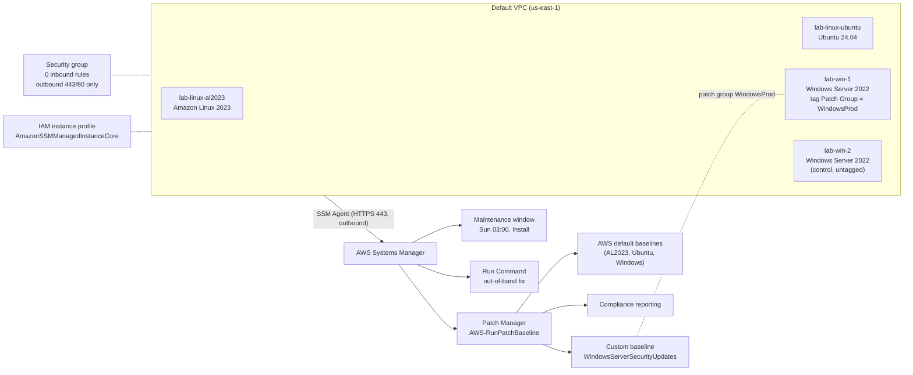

**Infrastructure as code:** [`infra/patch-lab-fleet.yaml`](infra/patch-lab-fleet.yaml) deploys the IAM role, a security group with no inbound rules, an IMDSv2-only launch template and four instances.

The Ubuntu and Windows AMIs are **deliberately pinned to older images** (April and June 2026). An image built this month scans as already compliant, so these older images give the scan real missing patches to find.

---

## What I built

### 1. A fleet with no inbound access, managed only through Systems Manager

The fleet is deployed with CloudFormation. The security group has **zero inbound rules**, IMDSv2 is enforced, and all four nodes register in Fleet Manager through the SSM Agent.

| CloudFormation stack | No inbound rules |
|---|---|
| 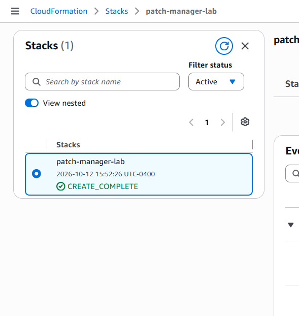 | 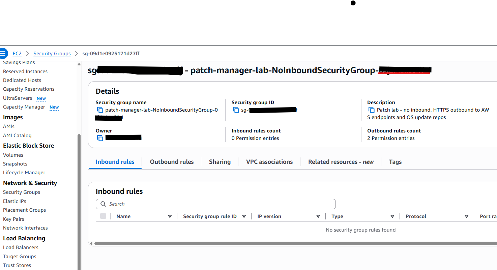 |

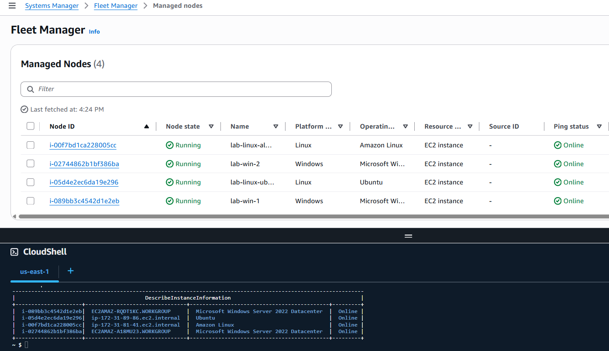
*All 4 nodes Online in Fleet Manager. The CloudShell output confirms the same 4 instances from the CLI.*

### 2. Baseline scan (the "before" state)

| Node | Baseline | Missing |
|---|---|---|
| lab-linux-al2023 | AWS default | 0 |
| lab-linux-ubuntu | AWS default | **160** |
| lab-win-1 | AWS default | **2** |
| lab-win-2 | AWS default | **2** |

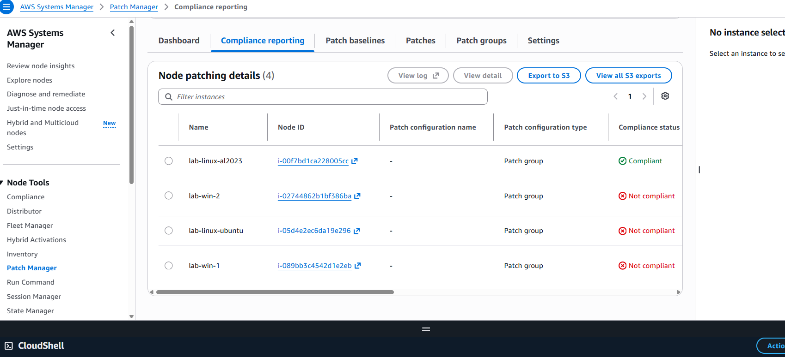

The Windows counts are low because Windows updates are cumulative: a single monthly rollup replaces the earlier ones.

### 3. Linux patching

`Scan and install` with `RebootIfNeeded` brought Ubuntu from 160 missing patches to 0 (installed packages went from 58 to 227). Amazon Linux was already current.

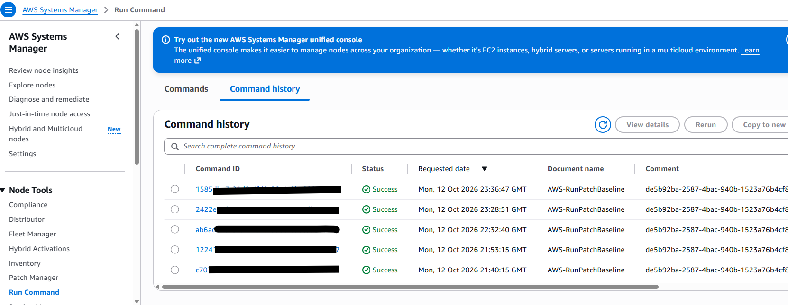

### 4. Custom Windows baseline and patch group

`WindowsServerSecurityUpdates`:
- Product: **WindowsServer2022**
- Classifications: **SecurityUpdates, CriticalUpdates**
- Severity: **Critical, Important**
- Auto-approval delay: **0 days**
- Compliance reporting level: **Critical**
- **Unapproved security updates are reported as Noncompliant**, so a security fix the rules don't approve still appears in compliance reports instead of disappearing from them.

It's linked to patch group `WindowsProd`. Only **lab-win-1** carries that tag. **lab-win-2** is left on the AWS default baseline as a control, to show the difference between the two baselines.

| Baseline | Unapproved security updates setting |
|---|---|
| 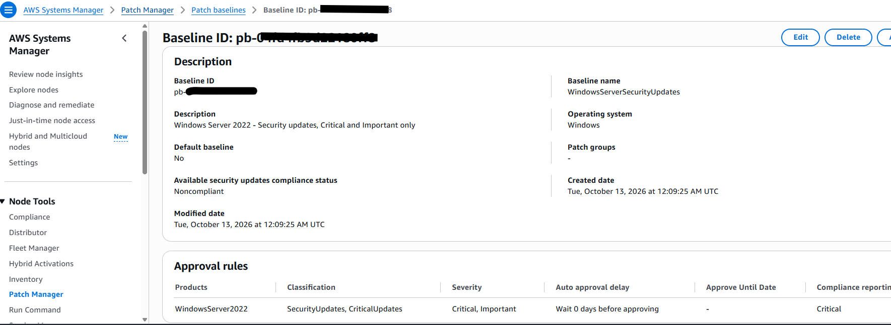 | 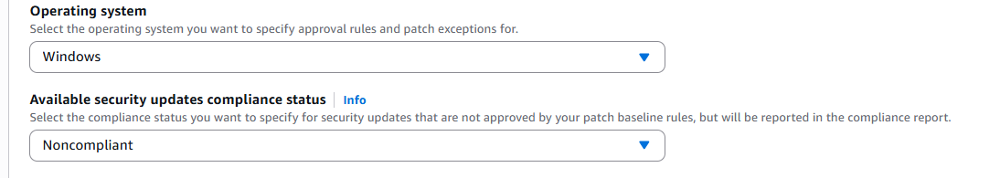 |

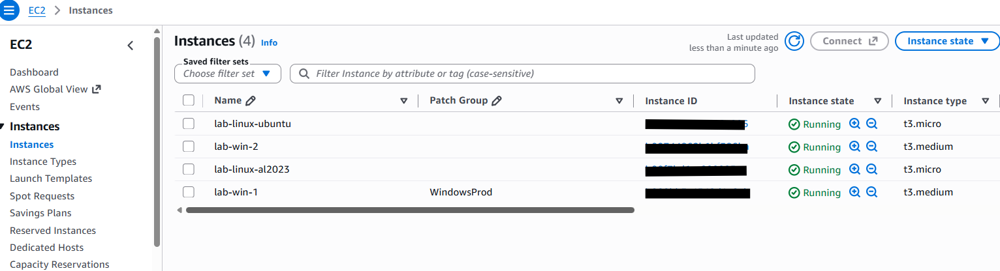

### 5. Windows patching and compliance

Both Windows nodes installed the 2026-09 cumulative update (KB5122882, Critical) and the .NET cumulative update (KB5126149, Important) with 0 failures. lab-win-1 reported the **custom baseline ID**, which confirmed that the patch group routed it correctly.

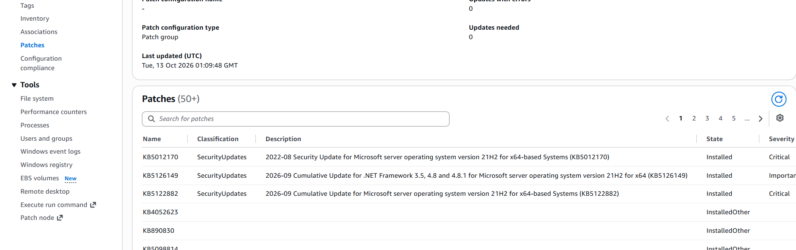

### 6. Automation with a weekly maintenance window

- **Maintenance window** `patch-windowsprod-weekly`: `cron(0 3 ? * SUN *)` America/New_York, 2-hour duration, 1-hour cutoff
- **Target:** `tag:Patch Group = WindowsProd`
- **Task:** `AWS-RunPatchBaseline`, Operation=Install, RebootOption=RebootIfNeeded, concurrency 1, error threshold 1. Patching one server at a time limits the impact if an update causes problems.
- Unregistered targets are not allowed.

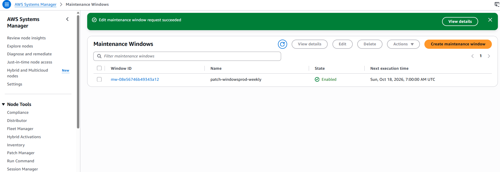

### 7. The "after" state

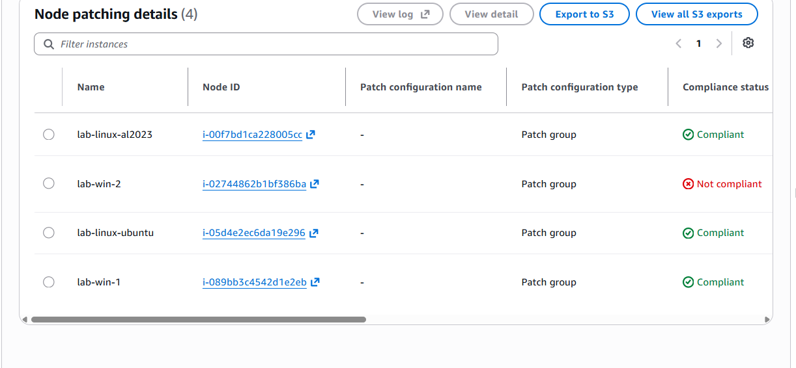

| Node | Baseline | Missing | Failed | Status |
|---|---|---|---|---|
| lab-linux-al2023 | AWS default | 0 | 0 | Compliant |
| lab-linux-ubuntu | AWS default | 0 (was 160) | 0 | Compliant |
| lab-win-1 | **Custom (WindowsProd)** | 0 (was 2) | 0 | **Compliant** |
| lab-win-2 | AWS default (control) | 0 (was 2) | 0 | Non-compliant, by design (see Issue 2) |

| Node detail (custom baseline) | Compliance dashboard |
|---|---|
| 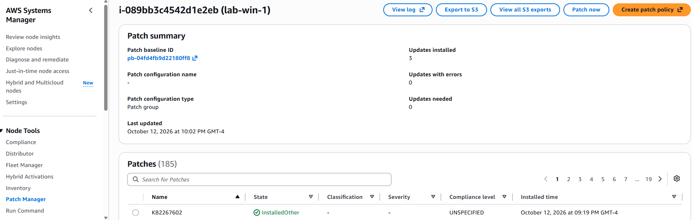 | 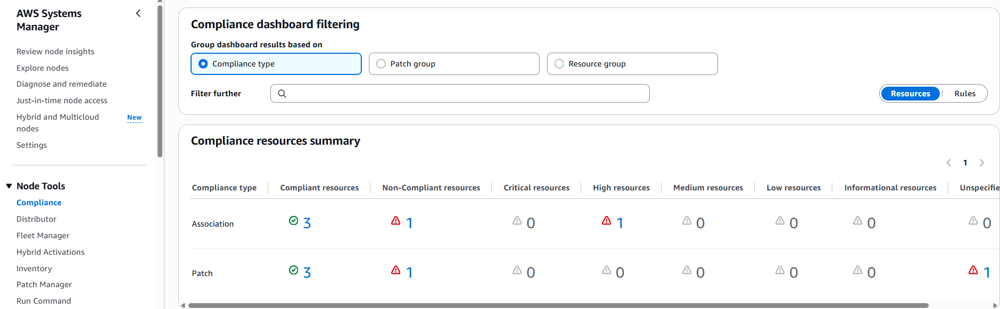 |

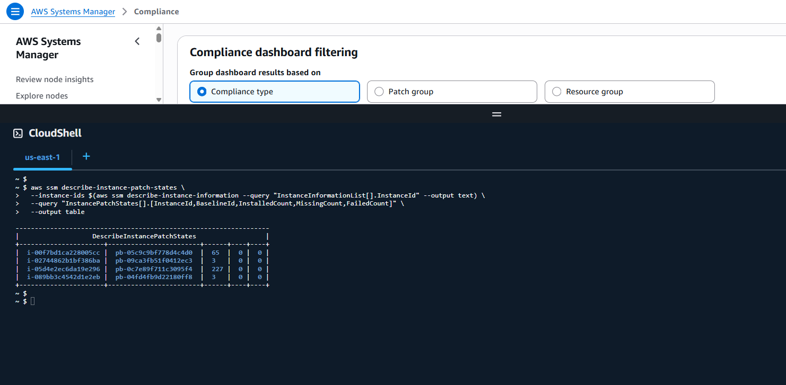

---

## Troubleshooting log

### Issue 1: A patch run failed on Ubuntu with a lock conflict
- **Symptom:** an Install run reported `Failed=1, Success=1`. Ubuntu failed with *"Cannot acquire lock on /var/log/amazon/ssm/patch-baseline-concurrent.lock. Another patching operation is in progress."*
- **Root cause:** **Patch now** had been submitted twice, eight minutes apart. The first run was still installing 160 packages on a t3.micro.
- **Resolution:** I left the first run to finish, and it completed successfully. The lock worked as designed: it kept two package-manager runs from operating on the same server at once.
- **Lesson:** check Run Command history for in-flight `AWS-RunPatchBaseline` runs before starting another. In production, a maintenance window's concurrency controls prevent this.

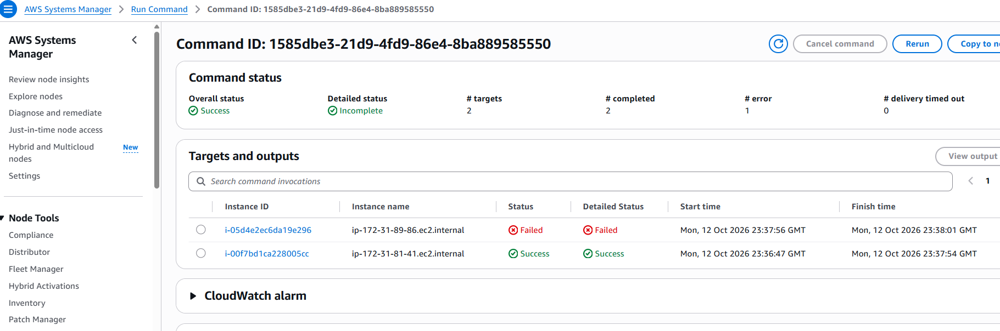

### Issue 2: Windows was still non-compliant after a successful install
- **Symptom:** both Windows nodes showed 0 missing and 0 failed but were still **Non-compliant**.
- **Investigation:** `describe-instance-patches` showed **KB5127069 (2026-09 Windows Recovery Environment Update)** in state `AvailableSecurityUpdate`. It's classified as *SecurityUpdates* but has **no MSRC severity**, so the Critical/Important rule didn't approve it. The baseline's *"report unapproved security updates as Noncompliant"* setting surfaced it, as intended.
- **First fix attempt:** I added KB5127069 to the baseline's explicit **Approved patches** list. The rerun still reported it as *"not approved by the baseline."*
- **Root cause:** `describe-available-patches` returned nothing for KB5127069. The update **isn't in Patch Manager's Windows patch catalog**, so no baseline rule or exception can match it, even though Windows Update on the server can see it.
- **Resolution:** I installed it on lab-win-1 using **Run Command** (`AWS-RunPowerShellScript` calling the Windows Update Agent API). It returned `ResultCode 2 = Succeeded` with no reboot needed. A rescan showed lab-win-1 **Compliant**.
- **Why lab-win-2 is still red:** I left it unfixed on purpose. It shows that a default-baseline server with no follow-up would carry this gap indefinitely.

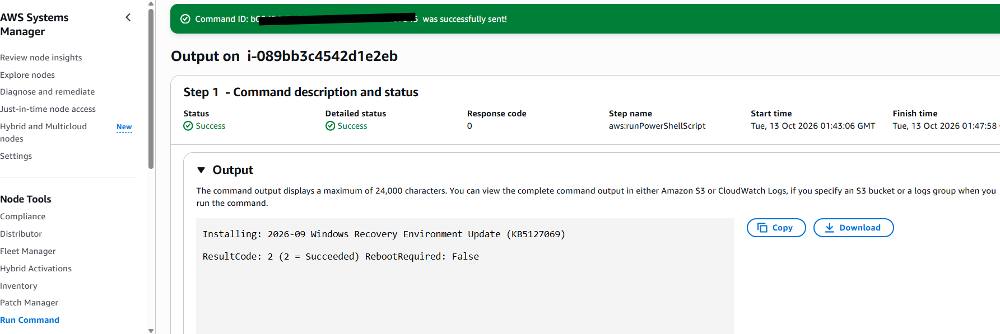

### Issue 3: The maintenance window task pointed at the wrong document
- **Symptom:** when I checked the window from the CLI, the task was registered with **`AWS-ApplyAnsiblePlaybooks`** (a sample hello-world playbook) instead of `AWS-RunPatchBaseline`. *Allow unregistered targets* was also enabled.
- **Resolution:** I deregistered the task, registered it again with `AWS-RunPatchBaseline` (Install / RebootIfNeeded), turned off unregistered targets, and confirmed both changes with `get-maintenance-window-task`. Both fixes were in place **before the first scheduled run**.
- **Lesson:** check every configuration through the API, not only in the console.

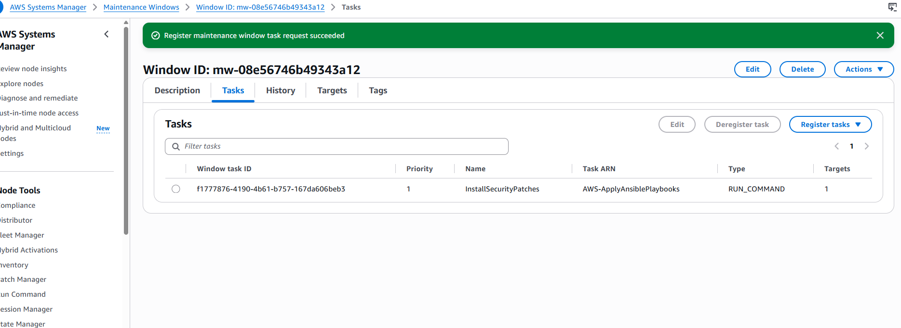

---

## Design decisions

| Decision | Why |
|---|---|
| No inbound rules; Systems Manager only | Removes SSH and RDP as attack surface, and every action is logged. |
| IMDSv2 required | Blocks SSRF-style theft of instance credentials. |
| Custom baseline: Security/Critical updates, Critical and Important severity | Keeps the change scope narrow, so the servers only get security fixes and avoid unnecessary feature updates. |
| 0-day auto-approval | Suits a lab. **In production I'd use about 7 days** so patches are tested in dev before they reach prod patch groups. |
| Unapproved security updates reported as Noncompliant | Security fixes that the rules don't cover still show up in reports. This is what exposed KB5127069. |
| Control node on the default baseline | Lets the custom and default baselines be compared side by side under identical conditions. |
| Concurrency 1, error threshold 1 in the maintenance window | Patches one server at a time and stops if one fails. |
| Older AMIs pinned in IaC | Makes the before/after reproducible. |

## What I'd add in production
- Separate **dev → prod patch groups** with staggered maintenance windows and a soak period between them.
- **SNS / EventBridge alerts** on failed patch runs and on compliance status changes.
- Patch logs written to **S3**, and compliance sent to **Security Hub** or **S3 + Athena** for reporting over time.
- Baselines, patch groups and maintenance windows defined in **CloudFormation or Terraform**, not created by hand in the console.
- **Pre- and post-patch hooks** (`AWS-RunPatchBaseline` lifecycle hooks) to drain servers from load balancers and run health checks.

## Cost and cleanup
- Runtime was about 6.5 hours, for an estimated **$1.40**.
- Teardown removed the maintenance window, the custom baseline and patch group, and the CloudFormation stack.
- I confirmed through the CLI that no instances, volumes, Elastic IPs, IAM roles or managed nodes were left.

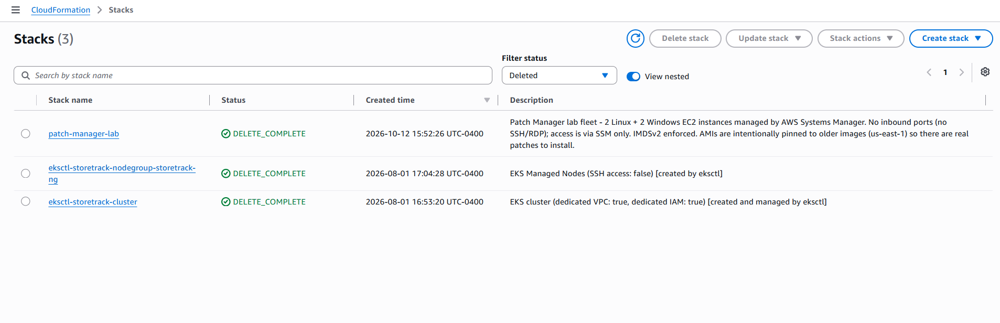

## Reproduce it
```bash
aws cloudformation deploy \
  --template-file infra/patch-lab-fleet.yaml \
  --stack-name patch-manager-lab \
  --capabilities CAPABILITY_NAMED_IAM \
  --parameter-overrides VpcId=<vpc-id> SubnetId=<public-subnet-id>
```
The pinned AMI IDs are for **us-east-1**. Delete the stack when you're finished: `aws cloudformation delete-stack --stack-name patch-manager-lab`.

Detailed run notes, with IDs and timestamps, are in [`lab-notes.md`](lab-notes.md).
